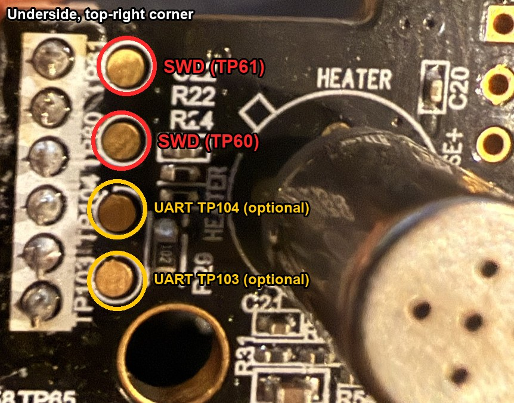

# Rewair (FrankBWalsh fork)

Bring an Awair V1 back to life with local, open firmware.

This is a fork of [naorunaoru/rewair](https://github.com/naorunaoru/rewair).
Everything upstream does still applies. This fork adds sensor calibration and a
display option, Windows build and flash support, and corrected wiring notes for
the SWD test points. Details are in [docs/fork-notes.md](docs/fork-notes.md).

## What's different in this fork

### Firmware

- **Dust and VOC calibration offsets.** A new **Settings → Calibration &
  display** panel sets an offset for dust (µg/m³) and VOC (ppb). The offset is
  subtracted from the sensor reading, never going below zero, before the
  readings reach the air score, the front display, the web app, MQTT/Home
  Assistant and Bluetooth. This corrects aging sensors that read high in clean
  air. The panel shows each sensor's current uncalibrated reading, so you can
  pick an offset from a clean-air baseline.
- **Hide the clock (experimental).** An option to stop the front display
  showing the time. The stock display board has no "score only" mode. This
  option withholds the time from it instead. Power-cycle the unit after
  enabling it.
- **New API route:** `GET/POST /api/calibration` (`dust_offset`, `voc_offset`,
  `hide_clock`). GET also returns the uncalibrated dust and VOC readings.
- Calibration is stored in its own record, so existing settings, Wi-Fi and
  MQTT configuration are untouched. Factory reset does not clear it; set the
  offsets back to 0.
- Local builds report the version as `0.9.1-dev.cal1`.

### Wiring: the SWD pads are TP60/TP61

The upstream docs say SWD is on `TP80`/`TP81`. On this fork's REV.5
(2015.11.30) board the SWD pads are silkscreened **`TP60`/`TP61`**:

- **Flip the main board over.** The pads are in the **top-right corner of the
  underside**.
- They are the **top two** of four round gold pads. The bottom two are
  `TP104`/`TP103` (debug UART, optional).
- The top side has other pads whose small, upside-down labels are easy to
  misread as TP80/TP81. Those are not SWD.



### Windows and Flipper Zero

- **Windows build:** `scripts/build_local_bridge.ps1` builds the firmware with
  the WICED SDK's own Win32 toolchain. The upstream scripts are macOS/zsh only.
- **SPI-flash backups on Windows:** `scripts/sflash_write_swd.tcl` no longer
  depends on a `/tmp` directory.
- **Flipper Zero as the SWD probe:** setup for the DAP Link app (pins 10/12),
  the Windows driver fix it needs, and a workaround for flash-erase failures
  over a marginal SWD link. See [docs/fork-notes.md](docs/fork-notes.md).

## Upstream features (unchanged)

- Simple Wi-Fi setup from a captive portal
- Live readings and settings in the built-in web app
- MQTT and Home Assistant discovery
- Firmware updates from the browser, with rollback protection
- Optional read-only access over Bluetooth

## Install

Follow the upstream
**[installation guide](https://github.com/naorunaoru/rewair/wiki/Getting-Started)**,
but wire the probe to the pads described above. To get this fork's features on
a unit already running Rewair, build the firmware (below) and upload the
`.bin` from **Settings → Firmware → Update** in the web app. No wiring is
needed for that.

## Build it yourself

Place this repository beside the
[WICED SDK](https://github.com/kamejoko80/wiced-emw3165), then run:

```sh
# macOS / Linux (upstream scripts)
scripts/build_local_bridge.zsh
scripts/flash_local_bridge_probe_rs.zsh
```

```powershell
# Windows
pwsh -File scripts\build_local_bridge.ps1
```

The upstream
[building guide](https://github.com/naorunaoru/rewair/wiki/Building-and-Flashing)
covers the required tools and flashing options.

## Learn more

- [docs/fork-notes.md](docs/fork-notes.md): this fork's hardware, Windows and
  feature notes
- The upstream [Wiki](https://github.com/naorunaoru/rewair/wiki): setup,
  development, networking, MQTT, the web API, firmware updates, hardware notes
  and recovery

> Rewair is experimental firmware. **Back up both internal and external flash
> before flashing**. Rewair does not distribute the stock images. Start with the
> [installation guide](https://github.com/naorunaoru/rewair/wiki/Getting-Started).
