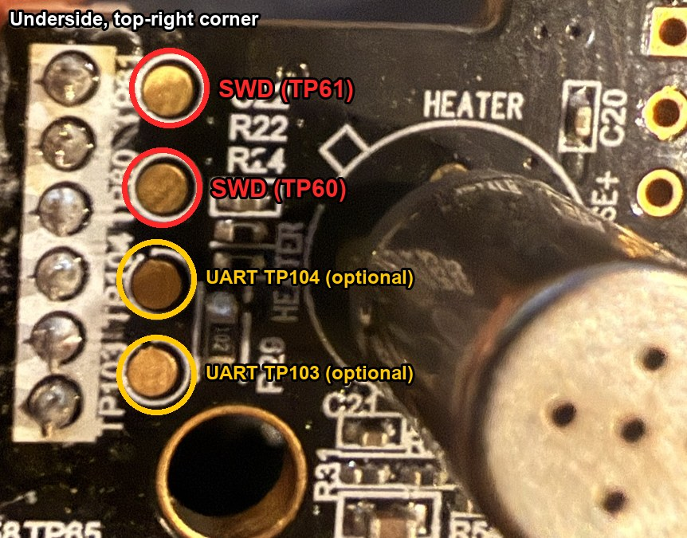

# Notes from this fork

Field notes from installing Rewair on an Awair V1 (main board marked
**AWAIR REV.5, 2015.11.30**) from **Windows 11** with a **Flipper Zero** as the
SWD probe, plus the firmware additions made along the way.

## The SWD test points are silkscreened TP60/TP61, not TP80/TP81

The upstream docs say SWD is on `TP80`/`TP81`. On this board the two SWD pads
are silkscreened **`TP60` / `TP61`**. They sit in a group of four round gold
pads with **`TP103` / `TP104`** (debug UART):

- **Flip the main board over.** The group is in the **top-right corner of the
  underside**, beside a row of six through-hole pins.
- The **top two** pads of the group are SWD (`TP61`, then `TP60`). The bottom
  two are `TP104` / `TP103` (UART, optional).



Watch out for the top side of the board. It has *other* small pads whose
upside-down labels are easy to misread as TP80/TP81 (for example a
`TP77 / TP79 / TP80 / TP90` row below the EMW3165 and a `TP81 / TP88 / TP85`
cluster to its right). Those are **not** the SWD pair, and wiring to them gives
`No target responded to the debug port` in every orientation.

Nothing documents which of TP60/TP61 is SWCLK and which is SWDIO. Try one
orientation and swap if the chip does not answer; swapping is harmless.

For reference, the EMW3165 datasheet puts SWD on **module pin 25 (PA14,
SWCLK)** and **pin 26 (PA13, SWDIO)**. Module pins 6 and 7 are the SPI flash.

## Flipper Zero as the probe

The official **DAP Link** app (Apps → GPIO) is a CMSIS-DAP v2 probe and works
with probe-rs and OpenOCD unchanged.

- In the app's config, set the SWD pins to **10/12 (SWC/SIO)**. The default
  may be 2/3. Exit and reopen the app after changing it.
- Wiring: Flipper **10 → SWCLK**, **12 → SWDIO**, **11 → GND**. Leave the
  Flipper's 5V and 3V3 unconnected and power the Awair from its own 12 V supply.
- **Windows driver gotcha:** if an STMicroelectronics VCP driver is installed,
  it claims the Flipper's VID/PID (0483:5740) as one COM port and hides the
  CMSIS-DAP interface (`probe-rs list` finds nothing). In Device Manager, update
  that COM port's driver to **USB Composite Device**. The CMSIS-DAP v2
  interface then appears.

## Flash erase over a marginal SWD link

Reads and the bootloader write worked at 950 kHz. The application write then
failed mid-erase (`Failed to erase flash sector … protocol error`). What worked:
erase sectors **one at a time with OpenOCD at 100 kHz**, then write and verify:

```sh
openocd -f interface/cmsis-dap.cfg -c "transport select swd" -f target/stm32f4x.cfg \
  -c "adapter speed 100" -c init -c "reset halt" -c "flash erase_sector 0 3 3" -c shutdown
# repeat for sectors 4, 5, 6 (the app spans 0x0800C000-0x0804AFFF), then:
openocd ... -c "adapter speed 100" -c init -c "reset halt" \
  -c "flash write_image rewair-application.bin 0x0800c000 bin" \
  -c "verify_image rewair-application.bin 0x0800c000 bin" -c "reset run" -c shutdown
```

## Windows

- The repo's helper scripts are zsh/macOS. `scripts/build_local_bridge.ps1`
  builds the firmware on Windows with the WICED SDK's own Win32 toolchain.
- `scripts/sflash_write_swd.tcl` used a hard-coded `/tmp` scratch file. It now
  writes the scratch chunk next to the output file, so SPI-flash backups also
  work on Windows.
- probe-rs installs with its PowerShell installer. OpenOCD 0.12 installs with
  `winget install xpack-dev-tools.openocd-xpack`.

## Firmware additions (Settings → Calibration & display)

- **Dust and VOC offsets.** These are subtracted (clamped at 0) from the
  processed readings before scoring, the front display, `/api/status`, SSE,
  MQTT and BLE. This compensates an aged GP2Y1023 dust sensor that reads high in
  clean air. The panel shows the current uncalibrated readings to pick offsets
  from.
- **Hide clock (experimental).** The stock F103 display firmware has no
  "score only" mode. Its known DISP modes are `default`, `score`, `clock`,
  `temp_c`, `temp_f`, `humid`, `dust`, `temp_humid_c` and `temp_humid_f`. It
  does log `Clock invalid display` when it has no valid time. This option stops
  sending `TIME` (TINF is still sent). Power-cycle the unit after enabling it.
- **New route:** `GET/POST /api/calibration` with `dust_offset` (µg/m³, 0–250),
  `voc_offset` (ppb, 0–60000), `hide_clock` (bool). GET also returns
  `dust_uncalibrated` / `voc_uncalibrated`.
- Values persist in their own app-DCT record (offset 256, magic `RWC1` plus a
  check word). Settings and MQTT config are untouched. Factory reset does not
  clear it; set the values to 0.
